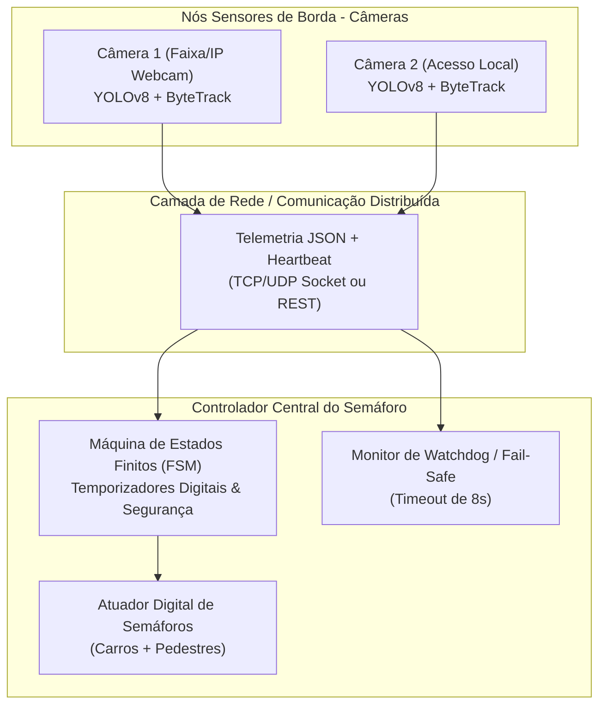

# Arquitetura Distribuída: Semáforo Inteligente com Visão Computacional

**Disciplina:** Sistemas Distribuídos e Sistemas Digitais  
**Aluno:** Murilo (Tomy)  

---

## 1. Visão Geral da Arquitetura

O sistema adota uma **Arquitetura Distribuída em Camadas (Edge-to-Controller)**, separando as responsabilidades de captura e inteligência visual (nós de borda) da lógica crítica de segurança e chaveamento de estados semafóricos (controlador central):



---

## 2. Protocolo de Comunicação (JSON Payload)

Cada nó de visão transmite telemetria periódica a cada frame processado (ou em intervalos de 500ms):

```json
{
  "node_id": "cam_01",
  "timestamp": 1730145600.123,
  "sequence_number": 1042,
  "payload": {
    "vehicles": 4,
    "pedestrians": 1,
    "animals": 0,
    "confidence_avg": 0.72
  },
  "heartbeat": true
}
```

---

## 3. Tolerância a Falhas e Fail-Safe (Conceito de Sistemas Distribuídos)

1. **Detecção de Falha por Ausência de Heartbeat:**
   * Se a câmera ou o link de rede cair por mais de **8 segundos**, o controlador assume o estado `FAIL_SAFE`.
2. **Operação em Modo Seguro:**
   * O semáforo chaveia para ciclo de temporização fixa padrão ou amarelo piscante de atenção.
   * Impede que uma pane de software ou desligamento de câmera congele o semáforo no vermelho perpetuamente.
3. **Recuperação Automática (Self-Healing):**
   * Assim que um novo pacote válido do nó de borda chega, o sistema transita com segurança pelo estado `VERMELHO_LIMPEZA` antes de retomar a adaptabilidade dinâmica.
