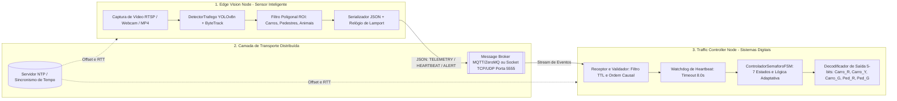
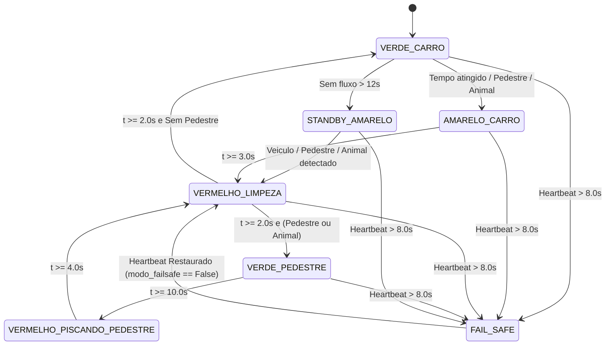

# Especificação Técnica: Arquitetura Distribuída e Controle Digital do Semáforo Inteligente

**Disciplinas Integradas:** Sistemas Distribuídos & Sistemas Digitais  
**Aluno:** Murilo (Tomy)  
**Diretório Base:** `~/projetos/semaforo`  
**Módulos de Referência:** `core/detector.py`, `core/fsm.py`, `main_integrated.py`

---

## 1. Visão Geral da Arquitetura

O sistema adota uma **Arquitetura Distribuída em Camadas (Edge-to-Controller)**, desacoplando o processamento pesado de visão computacional na borda (**Edge Vision Node**) da lógica determinística e crítica de chaveamento semafórico (**Traffic Controller FSM**), interconectados por uma camada de transporte assíncrona baseada em **Message Broker (MQTT/ZeroMQ) ou Socket TCP/UDP**.

Essa separação garante que falhas de inferência, gargalos de GPU/CPU na captura de vídeo ou partições de rede **jamais comprometam a segurança viária**, pois o controlador opera um laço determinístico local de tempo real (Sistemas Digitais) capaz de comutar autonomamente para estados de segurança (*Fail-Safe*).



---

## 2. Descrição dos Componentes

### 2.1. Edge Vision Node (`core/detector.py`)
Nó produtor responsável pela percepção do ambiente físico:
- **Pipeline de Inferência:** Utiliza `YOLOv8n` (`imgsz=320`, `conf=0.35`) combinado ao rastreador multi-objeto `ByteTrack` (`persist=True`) com salto de quadros configurável (`pular_frames=2` ou `3`) para manter baixa latência em hardware de borda.
- **Filtragem Espacial (ROI):** Aplica teste de inclusão poligonal (`cv2.pointPolygonTest`) sobre o centro geométrico de cada *bounding box* para contabilizar apenas objetos dentro da zona ativa da via.
- **Classes Monitoradas (COCO):**
  - **Veículos (`CLASSES_VEICULOS`):** Bicicleta (`1`), Carro (`2`), Moto (`3`), Ônibus (`5`), Caminhão (`7`).
  - **Pedestres (`CLASSE_PESSOA`):** Pessoa (`0`).
  - **Animais (`CLASSES_ANIMAIS`):** Pássaro (`14`), Gato (`15`), Cachorro (`16`), Cavalo (`17`), Ovelha (`18`), Vaca (`19`).

### 2.2. Message Broker / Canal de Socket (`distributed/`)
Camada intermediária de comunicação entre sensores de borda e o controlador semafórico:
- **Topologia Suportada:**
  1. **Pub/Sub via Broker (MQTT ou ZeroMQ `PUB/SUB`):** Permite múltiplos *Edge Vision Nodes* (ex.: câmera faixa norte, câmera faixa de pedestres) publicando em tópicos estruturados (`semaforo/cruzamento_01/telemetria`, `semaforo/cruzamento_01/heartbeat`, `semaforo/cruzamento_01/alerta`).
  2. **Socket Direto (UDP/TCP Framing):** Comunicação ponto a ponto de baixa latência onde cada pacote JSON é delimitado por quebra de linha (`\n` - *NDJSON*).
- **Semântica de Entrega:**
  - **Telemetria periódica e Heartbeat:** *At-most-once* (QoS 0 / UDP) com descarte de pacotes obsoletos (*stale frames*), priorizando sempre o estado mais recente da via.
  - **Eventos críticos de segurança (Animal na pista / Botoeira de Pedestre):** *At-least-once* (QoS 1 / TCP com ACK) com idempotência garantida por chave de sequência (`seq_num` / `sequence_number`).

### 2.3. Traffic Controller FSM (`core/fsm.py`)
Nó consumidor e unidade central de controle digital:
- **Natureza Híbrida (Sistemas Digitais):** Opera como uma Máquina de Estados Finitos (FSM) determinística onde a função de transição de próximo estado depende do **tempo decorrido no estado atual** (`tempo_no_estado`) e do **vetor de entradas dos sensores** `(veiculos, pedestres, animais, heartbeat_ok)`, enquanto a função de saída (`obter_luzes()`) decodifica o estado atual e o sub-ciclo de clock (`2 Hz`) em 5 sinais digitais para os atuadores.

---

## 3. Modelagem de Sistemas Digitais (FSM e Sinais de Saída)

### 3.1. Estados da Máquina (`EstadoSemaforo`)
A FSM possui 7 estados codificados em 3 bits (`Q2 Q1 Q0`):

| Código Binário | Enum (`EstadoSemaforo`) | Descrição Operacional | Duração / Condição de Transição |
| :---: | :--- | :--- | :--- |
| `000` | `VERDE_CARRO` | Fluxo aberto para veículos; calcula tempo verde adaptativo (`5.0s` a `30.0s`). | Sai para `AMARELO_CARRO` se `t >= T_calc`, ou se `(animais > 0 ou pedestres > 0)` após `min_verde_carro` (`5.0s`). Sai para `STANDBY_AMARELO` se rua deserta por `> 12.0s`. |
| `001` | `AMARELO_CARRO` | Atenção / desaceleração veicular. | Temporizador fixo: `tempo_amarelo = 3.0s` -> vai para `VERMELHO_LIMPEZA`. |
| `010` | `VERMELHO_LIMPEZA` | *All-Red* de segurança (limpeza de cruzamento antes de inversão de fase). | Temporizador fixo: `tempo_limpeza = 2.0s`. Se `pedestres > 0` ou `animais > 0`, vai para `VERDE_PEDESTRE`; senão, `VERDE_CARRO`. |
| `011` | `VERDE_PEDESTRE` | Travessia segura aberta para pedestres; veículos bloqueados. | Temporizador fixo: `tempo_verde_pedestre = 10.0s` (`8.0s` no modo integrado) -> vai para `VERMELHO_PISCANDO_PEDESTRE`. |
| `100` | `VERMELHO_PISCANDO_PEDESTRE` | Alerta de encerramento de travessia de pedestres. | Temporizador fixo: `tempo_pisca_pedestre = 4.0s` (`3.0s` no modo integrado) -> vai para `VERMELHO_LIMPEZA`. |
| `101` | `STANDBY_AMARELO` | Modo noturno/economia quando a via está deserta (`V=0, P=0` por `> 12.0s`). | Acorda imediatamente para `VERMELHO_LIMPEZA` se `veiculos > 0`, `pedestres > 0` ou `animais > 0`. |
| `111` | `FAIL_SAFE` | Estado de contingência por perda de comunicação com o nó de visão. | Acionado de qualquer estado se `agora - ultimo_heartbeat > 8.0s`. Ao restaurar comunicação, sai para `VERMELHO_LIMPEZA`. |

### 3.2. Tabela Verdade dos Atuadores Digitais (`obter_luzes()`)
Seja `CLK_2Hz = (int(tempo_no_estado * 2) % 2 == 0)` o sinal de clock de piscagem:

| Estado Atual | `Carro_R` | `Carro_Y` | `Carro_G` | `Ped_R` | `Ped_G` |
| :--- | :---: | :---: | :---: | :---: | :---: |
| `VERDE_CARRO` | `0` | `0` | `1` | `1` | `0` |
| `AMARELO_CARRO` | `0` | `1` | `0` | `1` | `0` |
| `VERMELHO_LIMPEZA` | `1` | `0` | `0` | `1` | `0` |
| `VERDE_PEDESTRE` | `1` | `0` | `0` | `0` | `1` |
| `VERMELHO_PISCANDO_PEDESTRE` | `1` | `0` | `0` | `CLK_2Hz` | `0` |
| `STANDBY_AMARELO` | `0` | `CLK_2Hz` | `0` | `0` | `0` |
| `FAIL_SAFE` | `0` | `CLK_2Hz` | `0` | `1` | `0` |

### 3.3. Função de Tempo Verde Adaptativo (`calcular_verde_adaptativo()`)
- `veiculos == 0`: `min_verde_carro` (`5.0s` / `6.0s`)
- `1 <= veiculos <= 3`: `8.0s`
- `4 <= veiculos <= 8`: `15.0s`
- `9 <= veiculos <= 15`: `22.0s`
- `veiculos > 15`: `max_verde_carro` (`30.0s` / `25.0s`)

---

## 4. Protocolo de Mensagens JSON

Todas as mensagens trafegam codificadas em UTF-8 no formato JSON (NDJSON em sockets TCP/UDP ou payload em tópicos MQTT/ZeroMQ). Todo pacote possui cabeçalho comum de rastreabilidade, controle de sequência e sincronismo temporal.

### 4.1. Envelope Padrão
| Campo | Tipo | Obrigatório | Descrição |
| :--- | :--- | :---: | :--- |
| `protocol_version` | `string` | Sim | Versão do schema (`"1.0"`). |
| `msg_type` | `string` | Sim | `TELEMETRY_UPDATE`, `HEARTBEAT`, `PRIORITY_INTERLOCK`, `CONTROLLER_STATUS`. |
| `node_id` | `string` | Sim | Identificador único do nó emissor (ex.: `"cam_01"` / `"edge-cam-norte-01"`). |
| `seq_num` (`sequence_number`) | `integer` | Sim | Contador monotônico crescente por nó (detecção de perda e *out-of-order*). |
| `lamport_ts` | `integer` | Sim | Timestamp lógico de Lamport `L(e)` para ordenação causal de eventos. |
| `wall_clock_ms` (`timestamp`) | `number` | Sim | Timestamp Unix (sincronizado via NTP) no instante da emissão. |
| `ttl_ms` | `integer` | Sim | Tempo de vida máximo da mensagem (padrão: `1500` ms para telemetria). |
| `heartbeat` | `boolean` | Sim | Sinalizador booleano de vivacidade do nó emissor (`true`). |
| `payload` | `object` | Sim | Dados específicos do tipo da mensagem. |

### 4.2. Mensagem de Telemetria (`TELEMETRY_UPDATE`)
Emitida pelo *Edge Vision Node* a cada ciclo de inferência (`5` a `15 Hz`, ou intervalos de `500ms`). Alimenta o método `fsm.atualizar_sensores(veiculos, pedestres, animais)` e renova implicitamente o *heartbeat*.

```json
{
  "protocol_version": "1.0",
  "msg_type": "TELEMETRY_UPDATE",
  "node_id": "cam_01",
  "seq_num": 10482,
  "sequence_number": 10482,
  "lamport_ts": 10510,
  "wall_clock_ms": 1793216789120,
  "timestamp": 1793216789.120,
  "ttl_ms": 1500,
  "heartbeat": true,
  "payload": {
    "frame_id": 31446,
    "inference_latency_ms": 18.4,
    "confidence_avg": 0.72,
    "roi_active": true,
    "vehicles": 6,
    "pedestrians": 1,
    "animals": 0,
    "counts": {
      "veiculos": 6,
      "pedestres": 1,
      "animais": 0
    },
    "detections": [
      {
        "track_id": 42,
        "tipo": "Carro",
        "classe_id": 2,
        "bbox": [140, 210, 310, 390],
        "centro": [225, 300]
      },
      {
        "track_id": 19,
        "tipo": "Pessoa",
        "classe_id": 0,
        "bbox": [410, 280, 445, 375],
        "centro": [427, 327]
      }
    ]
  }
}
```

### 4.3. Mensagem de Heartbeat (`HEARTBEAT`)
Emitida periodicamente a cada `1.0s` pelo *Edge Vision Node* mesmo quando não há mudança de cena, garantindo ao *Watchdog* do controlador que o nó de visão e o enlace de rede estão operacionais.

```json
{
  "protocol_version": "1.0",
  "msg_type": "HEARTBEAT",
  "node_id": "cam_01",
  "seq_num": 10483,
  "lamport_ts": 10511,
  "wall_clock_ms": 1793216790120,
  "ttl_ms": 2000,
  "heartbeat": true,
  "payload": {
    "status": "HEALTHY",
    "camera_fps": 29.8,
    "cpu_temp_c": 54.2,
    "model": "yolov8n.pt"
  }
}
```

### 4.4. Mensagem de Intertravamento de Prioridade (`PRIORITY_INTERLOCK`)
Disparada imediatamente em eventos críticos de segurança (detecção de animal na pista ou acionamento de botoeira de pedestre), exigindo confirmação (`ACK`) do controlador.

```json
{
  "protocol_version": "1.0",
  "msg_type": "PRIORITY_INTERLOCK",
  "node_id": "cam_01",
  "seq_num": 10484,
  "lamport_ts": 10512,
  "wall_clock_ms": 1793216790450,
  "ttl_ms": 5000,
  "heartbeat": true,
  "payload": {
    "trigger": "ANIMAL_ON_TRACK",
    "severity": "CRITICAL",
    "requires_ack": true,
    "counts": {
      "veiculos": 4,
      "pedestres": 0,
      "animais": 1
    }
  }
}
```

### 4.5. Mensagem de Estado do Controlador (`CONTROLLER_STATUS` / `ACK`)
Publicada pela FSM para painéis supervisórios (HUD / Dashboard) e confirmação de recebimento de eventos críticos.

```json
{
  "protocol_version": "1.0",
  "msg_type": "CONTROLLER_STATUS",
  "node_id": "traffic-ctrl-01",
  "seq_num": 4021,
  "lamport_ts": 10513,
  "wall_clock_ms": 1793216790462,
  "ttl_ms": 2000,
  "payload": {
    "estado_atual": "AMARELO_CARRO",
    "modo_failsafe": false,
    "tempo_no_estado_s": 0.1,
    "tempo_verde_calculado_s": 15.0,
    "ultimo_heartbeat_age_s": 0.012,
    "atuadores": {
      "carro_r": false,
      "carro_y": true,
      "carro_g": false,
      "ped_r": true,
      "ped_g": false
    },
    "ack_seq_num": 10484
  }
}
```

---

## 5. Tolerância a Falhas, Heartbeat e Fallback Autônomo

O sistema foi projetado sob o princípio **Fail-Safe by Default**. A ausência de mensagens ou a queda do nó de visão nunca trava o semáforo em estado inseguro.

### 5.1. Mecanismo de Detecção de Falhas (Watchdog de Heartbeat)
- **Frequência de Emissão (`T_hb`):** O *Edge Vision Node* envia `TELEMETRY_UPDATE` ou `HEARTBEAT` em intervalos `<= 1.0s`.
- **Janela de Tolerância (`T_timeout = 8.0s`):** No controlador (`core/fsm.py`, linhas 70-74), o atributo `self.ultimo_heartbeat` registra o instante da última atualização válida:
  ```python
  # Verificador de Timeout Distribuído (Fail-Safe)
  if agora - self.ultimo_heartbeat > 8.0 and not self.modo_failsafe:
      self.modo_failsafe = True
      self._mudar_estado(EstadoSemaforo.FAIL_SAFE)
      return
  ```
- **Critério de Queda:** Se `agora - ultimo_heartbeat > 8.0s` (perda consecutiva de 8 janelas de 1s), o controlador declara falha da câmera ou partição de rede.

### 5.2. Comportamento em Fallback Autônomo
Ao detectar a falha, o controlador assume operação autônoma local em dois níveis complementares:
1. **Modo `FAIL_SAFE` de Segurança Imediata (Implementado em `core/fsm.py`):**
   - Aciona **Amarelo Piscante (`2 Hz` / alternância a cada `0.5s`)** para veículos (`Carro_Y = pisca`) e **Vermelho Fixo** para pedestres (`Ped_R = True`), sinalizando atenção obrigatória no cruzamento e bloqueando travessia desprotegida.
   - Mantém o temporizador de estado renovado a cada `15.0s` enquanto `modo_failsafe == True`.
2. **Ciclo Temporizado Fixo Autônomo (Fallback de Contingência para Vias Arteriais):**
   - Caso a política do cruzamento exija controle ativo de fases mesmo sem câmera, o nó controlador chaveia para temporização fixa padrão (`VERDE_CARRO [15s] -> AMARELO_CARRO [3s] -> VERMELHO_LIMPEZA [2s] -> VERDE_PEDESTRE [10s] -> VERMELHO_PISCANDO_PEDESTRE [4s] -> VERMELHO_LIMPEZA [2s]`), impedindo que uma pane de câmera ou rede congele o semáforo perpetuamente.

### 5.3. Recuperação Automática (*Self-Healing*)
Quando a câmera ou o broker se recupera e uma nova mensagem válida é recebida:
1. `fsm.atualizar_sensores(...)` atualiza `self.ultimo_heartbeat = time.time()` e define `self.modo_failsafe = False`.
2. No próximo pulso de `fsm.tick()`, a FSM sai de `FAIL_SAFE` **obrigatoriamente para `VERMELHO_LIMPEZA` (`2.0s`)** (linhas 79-80 de `core/fsm.py`) antes de abrir qualquer sinal verde, garantindo esvaziamento seguro do cruzamento.



---

## 6. Sincronização de Relógio e Ordenação de Eventos

Em um sistema distribuído de controle de tráfego, discrepâncias de relógio (*clock skew*) ou reordenação de pacotes na rede podem fazer o controlador tomar decisões baseadas em quadros antigos (*stale data*). A arquitetura adota uma estratégia híbrida: **Relógios Físicos (NTP / Algoritmo de Cristian)** para validade temporal (TTL) e **Relógios Lógicos (Lamport + Sequência Monotônica)** para ordem causal.

### 6.1. Sincronização de Relógio Físico (NTP + Algoritmo de Cristian)
1. **Sincronismo Base (NTP):** Tanto o *Edge Vision Node* quanto o *Traffic Controller* sincronizam seus relógios de sistema (`CLOCK_REALTIME`) via daemon `chrony`/`systemd-timesyncd` com um servidor NTP local, mantendo o desvio `|offset| < 10 ms`.
2. **Estimativa de Offset pelo Algoritmo de Cristian (Fallback em LAN Isolada):**
   Quando operando em rede dedicada sem acesso externo, o *Edge Vision Node* envia periodicamente um pacote `TIME_SYNC_REQ` no instante local `t0` ao controlador, que anota seu timestamp `t_server` e devolve `TIME_SYNC_RESP`, recebido pelo nó de visão em `t1`:
   - **Round-Trip Time (RTT):** `delta = t1 - t0`
   - **Offset Estimado:** `theta = t_server + (delta / 2) - t1`
   - O nó de visão corrige os timestamps emitidos usando `wall_clock_ms = t_local + theta`.
3. **Validação de Validade Temporal (Filtro TTL):**
   Ao receber uma mensagem com `wall_clock_ms` (`t_msg`) e `ttl_ms` (`TTL`), o controlador calcula a idade do pacote:
   - `idade_ms = t_ctrl_ms - t_msg`
   - Se `idade_ms > TTL` (ex.: pacote ficou retido em fila de retransmissão por mais de `1500 ms`), os dados de contagem são descartados para evitar decisões sobre tráfego já dissipado.

### 6.2. Relógios Lógicos de Lamport e Prevenção de *Out-of-Order*
Para garantir consistência causal mesmo sob *clock drift* residual:
1. **Contador Monotônico (`seq_num` / `sequence_number`):** O controlador armazena `last_seq_num[node_id]`. Qualquer pacote `TELEMETRY_UPDATE` com `seq_num <= last_seq_num[node_id]` é descartado imediatamente como duplicata ou entrega fora de ordem (*out-of-order delivery*).
2. **Relógio Lógico de Lamport (`lamport_ts`):**
   - Antes de enviar qualquer evento (`TELEMETRY_UPDATE`, `HEARTBEAT`, `PRIORITY_INTERLOCK`), o nó incrementa seu relógio lógico: `L_i = L_i + 1`.
   - Ao receber uma mensagem com carimbo `L_msg`, o receptor atualiza seu contador lógico: `L_j = max(L_j, L_msg) + 1`.
   - Isso preserva a relação *happens-before* (`a -> b => L(a) < L(b)`) nos logs distribuídos entre a detecção de emergência na câmera, a transição de estado na FSM e o `ACK` emitido pelo controlador.
3. **Isolamento da Base de Tempo da FSM (`CLOCK_MONOTONIC`):**
   As durações das fases semafóricas (`tempo_amarelo = 3.0s`, `tempo_limpeza = 2.0s`, `timeout_heartbeat = 8.0s`) são medidas exclusivamente pelo relógio monotônico local do controlador, garantindo que ajustes abruptos de NTP (*clock step*) jamais encurtem um tempo de amarelo ou de limpeza de cruzamento.
